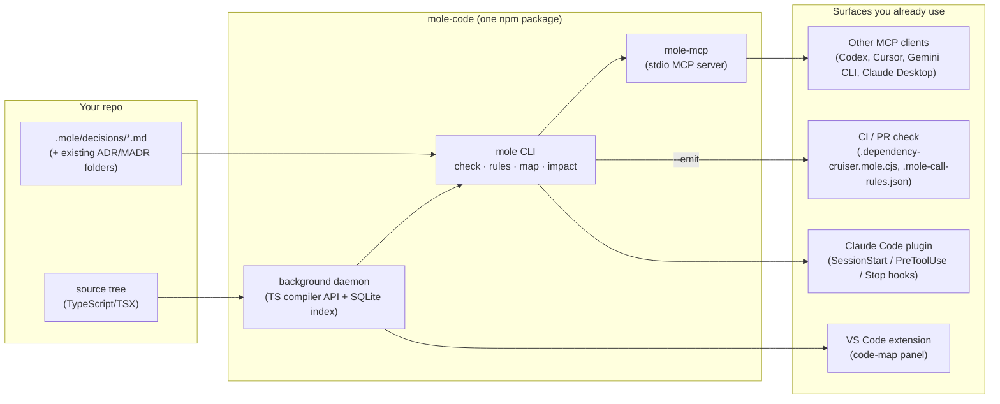
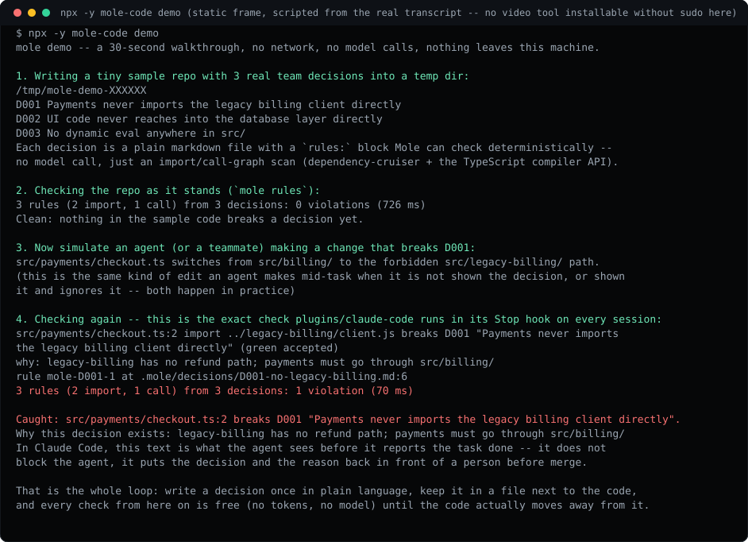

# Mole

[](https://github.com/raychu23/mole-code-map/actions/workflows/check.yml)
[](https://github.com/raychu23/mole-code-map/releases)
[](LICENSE)

<!-- An npm badge is intentionally not added yet: `mole-code` is not published to npm until a maintainer
     runs scripts/publish-all.sh (see "Source build vs. packaged builds" below) — a badge pointing at an
     unpublished package renders as a broken/invalid badge, which reads worse than no badge. Add
     `[](https://www.npmjs.com/package/mole-code)`
     right after the line above once that publish has happened. -->

**Everything you need to trust code you didn't write, in the editor you already use** — why it's built this
way, whether that's still true, and whether an agent's "done" is real. One install. No new tab. No tokens
for the checks.

## Works inside tools you already have

Mole is not a new place to work — it's hooks and a CLI inside the tools and standards most teams already
run. It reads/writes plain files, not a proprietary format, so it composes instead of replacing:

| Already in your stack | What Mole adds there |
|---|---|
| **Claude Code** | A plugin (`/plugin install mole`): `SessionStart`, `PreToolUse` and `Stop` hooks put decisions and past fixes in the agent's context automatically — no copy-paste. |
| **VS Code** (and VS Code forks) | The original `mole-code-map` panel — a code map beside the file you're editing — kept as one feature, unchanged. |
| **Any MCP client** — Codex, Cursor, Gemini CLI, Claude Desktop | `mole-mcp`: the same decisions/map/check/recall tools over MCP, so a non-Claude-Code agent gets the same context. |
| **ADR folders / MADR / spec-kit** | `mole check --spec-kit --adr-dir DIR` reads existing `.adr`/`MADR`-style records and plain ADR folders directly — Mole adds a `rules:` block and enforcement, it does not ask you to migrate off them. |
| **GitHub Actions / any CI** | `mole rules --emit` writes a `.dependency-cruiser.mole.cjs` + `.mole-call-rules.json` pair that a normal CI job (or a PR check) can run with no Mole-specific runner. |
| **Any repo, scripted** | One npm package (`mole-code`); `npx mole-code --help` works with no install step. |

See "How Mole compares" below for the specific tools (CodeRabbit, Greptile, adr-tools, Claude Code's own
memory, Graphiti/Zep, claude-mem, Swimm) this sits next to rather than replaces.

## Architecture



No model call anywhere in this diagram: the daemon, CLI, rule checks and MCP tools are all local and
deterministic — a model only enters if the surface on top of Mole (e.g. Claude Code itself) chooses to use
the context Mole hands it.

## The problem, plainly

Teams write decisions in Slack threads, PR comments and people's heads. Agents write code fast and don't
know those decisions exist unless someone pastes them in every time. Nobody re-checks an old decision
against the code that's supposed to follow it, so by the time someone notices it's already wrong in
production. Mole keeps a small number of team decisions as plain files next to the code, and checks them
for free, every time — no LLM call, no dashboard to open, no separate tool to remember to run.

Mole is not a map-only tool, not a chat-memory tool and not a reviewer that re-explains your diff. It is one
thing: **keep the team's decisions visible and verifiably still true**, where you already work. (The
original `mole-code-map` panel — a code map beside the file you're editing — is still here, as one feature;
see "Repository layout" below.)

## See it work (30 seconds, no setup)

```sh
npx -y mole-code demo
```

This writes a throwaway sample repo with 3 real team decisions (as plain `.mole/decisions/*.md` files with a
`rules:` block — see [`docs/decisions-and-rules.md`](docs/decisions-and-rules.md)), runs the same check
clean, then makes an edit that breaks one and shows the check catching it — the identical check Mole's
Claude Code hook runs on every session. Real transcript, captured from a clean install:

```
$ npx -y mole-code demo
mole demo -- a 30-second walkthrough, no network, no model calls, nothing leaves this machine.

1. Writing a tiny sample repo with 3 real team decisions into a temp dir:
   D001  Payments never imports the legacy billing client directly
   D002  UI code never reaches into the database layer directly
   D003  No dynamic eval anywhere in src/

2. Checking the repo as it stands (`mole rules`):
   3 rules (2 import, 1 call) from 3 decisions: 0 violations (458 ms)
   Clean: nothing in the sample code breaks a decision yet.

3. Now simulate an agent (or a teammate) making a change that breaks D001:
   src/payments/checkout.ts switches from src/billing/ to the forbidden src/legacy-billing/ path.

4. Checking again -- this is the exact check plugins/claude-code runs in its Stop hook on every session:
   src/payments/checkout.ts:2  import ../legacy-billing/client.js  breaks D001 "Payments never imports
   the legacy billing client directly" (green accepted)
       why: legacy-billing has no refund path; payments must go through src/billing/
   3 rules (2 import, 1 call) from 3 decisions: 1 violation (41 ms)

   Caught: src/payments/checkout.ts:2 breaks D001.
   In Claude Code, the agent never gets this far: the edit hook refuses an edit that adds the violation,
   and the stop hook sends the agent back with this decision and reason until it is fixed
   (only rules it can check exactly; set MOLE_STOP_BLOCK=0 to make it advice only).
```

Static frame of the same transcript, generated from it so the two cannot drift apart:




## Install

Pick the surface you already use — Mole is one `npm` package (`mole-code`) underneath all of them.

**Claude Code plugin** (recommended — hooks run at session start, on a governed edit, and at stop):
```
/plugin marketplace add raychu23/mole-code-map
/plugin install mole
```

**VS Code / VS Code forks** (the code-map panel, a feature of this same repo — see
[`apps/vscode`](apps/vscode)): download the `.vsix` from the [releases page](https://github.com/raychu23/mole-code-map/releases)
and `code --install-extension <file>`. VS Code Marketplace / Open VSX listings are planned.

**CLI, any repo:**
```sh
npx mole-code --help
npm install -g mole-code   # or
```

**MCP, any client** — point the client's command at `mole-mcp` with no args (`MOLE_ROOT` env var picks the
repo; defaults to cwd):

<details><summary>Codex (<code>~/.codex/config.toml</code>)</summary>

```toml
[mcp_servers.mole]
command = "npx"
args = ["-y", "-p", "mole-code", "mole-mcp"]
```
(or, if installed globally: `command = "mole-mcp"`, `args = []`)
</details>

<details><summary>Cursor (<code>.cursor/mcp.json</code>)</summary>

```json
{
  "mcpServers": {
    "mole": { "command": "npx", "args": ["-y", "-p", "mole-code", "mole-mcp"] }
  }
}
```
</details>

<details><summary>Gemini CLI (<code>~/.gemini/settings.json</code>)</summary>

```json
{
  "mcpServers": {
    "mole": { "command": "npx", "args": ["-y", "-p", "mole-code", "mole-mcp"] }
  }
}
```
</details>

<details><summary>Claude Desktop (<code>claude_desktop_config.json</code>)</summary>

```json
{
  "mcpServers": {
    "mole": { "command": "npx", "args": ["-y", "-p", "mole-code", "mole-mcp"] }
  }
}
```
</details>

## What it does, by job

**Keep the team's decisions enforced** — write a decision once in plain language
(`mole decision new --id D001 --title "..." --body "..."`); give it an optional `rules:` block (forbidden
import or call) and every future change is checked against it for free, forever (`mole rules`,
[`docs/decisions-and-rules.md`](docs/decisions-and-rules.md)).

**Know whether an edit touches a past fix** — `mole check` shows past fixes on the lines a change edits,
with their reason, the guarding test, and up to 3 questions worth asking before merging
([`docs/check-and-questions.md`](docs/check-and-questions.md)).

**See what a function calls, who calls it, what it breaks** — the code-map panel (VS Code) and `mole map` /
`mole impact` (CLI/MCP), unchanged from the original `mole-code-map` extension and kept as a feature
([`docs/code-map.md`](docs/code-map.md)).

**Leave yourself notes that survive a rename** — `mole note add <file#Symbol> "text"`; a note tracks its
symbol through renames and flags itself stale when the code under it changes
([`docs/notes-and-memory.md`](docs/notes-and-memory.md)).

**MCP tools for any agent** — the same decisions, map and check surfaced as MCP tools, so Codex, Cursor and
Gemini CLI get the same context Claude Code's hooks do ([`docs/mcp.md`](docs/mcp.md)).

## Verified numbers, with sources

Every number below is quoted, not estimated, from this project's internal verification notes (kept outside
this public repository, reviewed independently before publication). Full methodology, including the honest
negative result below, is in [`docs/how-we-measure.md`](docs/how-we-measure.md).

| Claim | Number |
|---|---|
| Test selection: catches the same regressions as running everything, at a fraction of the cost | Mole catches 10/10 injected regressions while running **1.2%** of the full test suite (163/14,065 tests), vs. running 100% for the same result — independently reviewed, recomputed from a frozen test key |
| A no-model decision-conflict checker vs. an LLM judge, same decisions | Mole 28/29 caught vs. the LLM-judge baseline 29/29; about half the false alarms (4/60 vs 9/60); roughly 13× lower estimated inference cost — **not** a demonstrated accuracy advantage; model labels were not human-audited |
| Incremental re-check vs. a full re-solve of a formal argumentation engine | On one ICCMA19 benchmark graph (`admbuster_10000`, one edge removed), incremental p50 7.17 ms vs. full re-solve p50 2,081.87 ms (15/15 matching results before/after) — a specific benchmark result, not a universal 10k-node claim (a second graph measured 17.2 ms vs 36.7 ms) |

**What we will not claim:** in a pre-registered 72-run test on the public dcbench agent-task benchmark (one coding
agent, 8 tasks × 3 setups × 3 runs), giving the agent Mole's context scored **23.6%** of available decision-compliance
points, against **27.6%** with the decisions pasted into a plain rules file and **31.7%** with no context at all
(3, 5 and 4 merge-ready diffs out of 24). None of these differences is statistically significant (paired permutation
test on task means, n = 8 tasks: p = 1.0 and 0.375), and neither context setup beat no context. Mole's hooks named the
right decision for 15 of 18 scored checks; the agent still missed decisions it had just been shown, and in this setup
the end-of-run check did not force a fix. Mole's runs did use fewer tokens (36.2 M vs 40.3 M and 46.9 M). We are not
claiming a productivity gain anywhere on this page.

## How Mole compares (fetched 2026-11-03)

| Tool | What it actually does | Where it's ahead of Mole | Where Mole differs |
|---|---|---|---|
| **CodeRabbit** | Cloud PR-time AI review: codegraph, team-history context, pre-merge checks, slop detection | Broad, model-driven review across any finding type; mature product, enterprise controls | Mole checks a *small, team-written* set of decisions deterministically (0 model calls) and locally, at session-start/edit/stop — not PR-time cloud review |
| **Greptile** | Cloud PR-time AI review with cross-file understanding, Claude Code plugin, `/greploop` agent-resolve loop | Same lane as CodeRabbit; tighter agent-loop integration | Same difference as above; Mole is not a PR reviewer |
| **Cursor rules / shared instructions file** | Static prompt text always or conditionally loaded into context; by Cursor's own docs, not enforced — "LLMs don't retain memory between completions" | Zero setup, works today in Cursor | Mole's decisions are *checked*, not just shown — a rule with a `rules:` block fails a real import/call-graph scan, not just a prompt |
| **Claude Code memory (project instructions + auto memory)** | Human-written project instructions + Claude-written auto memory, both loaded as context, explicitly "not enforced configuration" | Built into the harness already, zero extra install | Same distinction: Mole's decisions are re-verified against the code every time, not just re-read as a prompt |
| **Graphiti / Zep** | General-purpose temporal knowledge graph for agent/enterprise memory; facts invalidated by *newer facts* | Mature, general entity/fact modeling, hybrid search, managed hosting (Zep) | Mole is narrow and code-anchored: decisions are invalidated by *the code changing*, not by a contradicting later statement |
| **claude-mem** | Session-observation memory (SQLite + vector search) over what happened in past Claude Code sessions | Rich session recall, multi-harness install | Mole stores *team decisions*, not session transcripts, and checks them against current code rather than searching history |
| **Swimm** | Enterprise `/ask` Q&A + auto-synced docs + MCP "grounding layer," built by Swimm's consultants per codebase | Broader knowledge coverage, polished product, enterprise support | Mole is free, local, and open; a decision with a `rules:` block is enforced the moment it's written, no build-out service |
| **ADR tools (adr-tools, MADR)** | Plain-markdown ADR files + a CLI to create/supersede them | Simple, widely known format | Nothing in adr-tools checks an ADR's claim against the code — Mole's `rules:` block is the enforcement adr-tools never had |

**The honest read:** every named tool above does one piece of this well — review, prompt context, general
memory, or documentation. None of them checks a small set of *team-written* decisions against the actual
code, for free, inside the editor or agent harness a developer already has open. That's the gap Mole fills.
A startup doing one of these pieces well is validation that the piece matters, not a reason Mole is wrong to
exist — judge the whole assembly. The nearest real competitive pressure is Claude Code's own auto memory and
CodeRabbit/Greptile's "learnings" features: both are reachable, free, zero-install alternatives for a team
that doesn't need enforcement, just a reminder.

## AGENTS.md / CLAUDE.md precedence

Put Mole's decisions above a stale instruction file's own wording, in the place agents already treat as
instructions: the project's own `AGENTS.md`/`CLAUDE.md` (read by Claude Code, Codex, Cursor, Gemini CLI). Add
this one sentence. Why one sentence can matter: in a 320-run study of Claude Code and Codex CLI, a single
precedence sentence in the user's instruction file raised the share of choices that followed the existing
code over a stale file from 4.2% to 91.4% ([arXiv 2610.30571](https://arxiv.org/abs/2610.30571), 2026-10).
That study gave the *code* precedence; giving Mole's decisions precedence is the same mechanism but has not
been measured yet.

```markdown
When a `.mole/decisions/*.md` rule and this file's guidance disagree, the Mole decision wins; treat a
Mole Stop-hook violation (`decision: "block"`) the same as a failing test — fix the code before finishing.
```

## CI: block a PR on a decision-rule violation

Simplest: the Mole action (works today, builds Mole from this repo; pin a tag):

```yaml
name: mole
on: [pull_request]
permissions: { contents: read, checks: write }
jobs:
  mole:
    runs-on: ubuntu-latest
    steps:
      - uses: actions/checkout@v4
        with: { fetch-depth: 0, persist-credentials: false }
      - uses: actions/setup-node@v4
        with: { node-version: '22' }
      - uses: raychu23/mole-code-map@v0
        with: { token: ${{ github.token }} }
```

Or without the action, once `mole-code` is on npm: Mole's own repository runs a required GitHub Actions check this way (`.github/workflows/mole-pr-check.yml`
+ `.github/actions/mole-check`) — not a new, invented Action, the same one dogfooded here. For a repo built
from this monorepo's own checkout, copy both files as-is. For a repo that only has the published
`mole-code` npm package (no Mole source checkout), swap the "build mole" step for installing the package:

```yaml
name: mole pr-check
on:
  pull_request:
    types: [opened, synchronize, reopened]
permissions:
  contents: read
  checks: write
jobs:
  mole:
    name: mole-pr-check (runner)
    runs-on: ubuntu-latest
    timeout-minutes: 15
    steps:
      - uses: actions/checkout@v4
        with: { fetch-depth: 0, persist-credentials: false }
      - uses: actions/setup-node@v4
        with: { node-version: '22' }
      - name: install mole-code
        run: npm install --no-save mole-code
      - name: mole pr-check
        run: npx mole-code pr-check --event "$GITHUB_EVENT_PATH" --root . --out "$RUNNER_TEMP/mole-check-run.json"
      - name: post the check run
        env:
          GH_TOKEN: ${{ github.token }}
        run: gh api --method POST "repos/$GITHUB_REPOSITORY/check-runs" --input "$RUNNER_TEMP/mole-check-run.json" --jq '.html_url'
```

Make "mole" a required status check under branch protection and a PR can't merge while it fails. Forked
PRs get a read-only token from GitHub, so posting the check run fails there (403); run it on your own branches.

## Limits

- TypeScript/TSX only (indexer, rules, code map).
- Rule enforcement (`rules:`) checks import/call graphs; it does not understand runtime behavior.
- Tested on macOS (arm64) so far; other platforms degrade gracefully (native dependency falls back, logged).
- No productivity claim yet (see "What we will not claim" above) — a larger pre-registered agent-task run is
  in progress.
- Local only: no network calls, no telemetry, no AI model calls in the core checks described here.

### Source build vs. packaged builds

The npm package (`mole-code`), the VS Code extension and the Claude Code plugin contain everything below. A build from
this repository's source does not include two internal packages: agent-session state and coverage tracking. So in a
source build `mole runs`, `mole agents`, `mole claims`, `mole steer query` and the MCP tools `mole_coverage`,
`mole_claims`, `mole_tried`, `mole_collisions` and `mole_agent_intent` stop with
"not part of the open-source Mole build". Use the packaged builds for those.

## Repository layout

| Folder | What it is |
|---|---|
| `packages/daemon` | the `mole` CLI (`check`, `rules`, `decisions`, `map`, `impact`, `demo`, `note`, `memory`, ...) + per-repo background daemon |
| `packages/decisions` | decision records, `rules:` enforcement, incidents, priorities, recall |
| `packages/core`, `packages/indexer` | TypeScript-compiler-API graph + SQLite |
| `packages/history`, `packages/questions` | past fixes on edited lines, L3 questions |
| `packages/memory` | `mole note` / `mole memory` / `mole since` (notes that survive a rename) |
| `apps/vscode` | the VS Code extension: the original code-map panel, kept as a feature |
| `plugins/claude-code` | the Claude Code plugin (hooks, MCP) |
| `release/mole-code` | the single published `mole-code` npm package (CLI + `mole-mcp` + the plugin) |
| `docs/` | per-feature docs: how to use, what it reads/writes, limits, and [`docs/how-we-measure.md`](docs/how-we-measure.md) (benchmarks methodology, including the honest T63 negative result) |
| `site/` | this project's GitHub Pages landing site |

## Build

```sh
npm install
npm run check                          # build + tests
npm run package -w @mole/vscode        # apps/vscode/mole-code-map-<version>.vsix
```

Needs Node 22.13 or newer (`node:sqlite`).

## License

MIT, see `LICENSE`.
