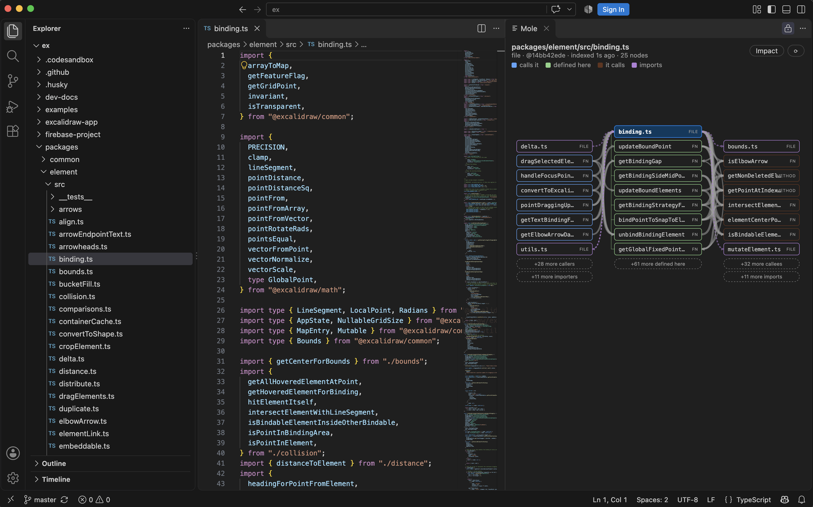

# Mole: Code Map

A map of the file you are looking at, in a panel beside the code (VS Code and VS Code forks). Open a TypeScript file and see what it
defines, who calls it, what it calls and who imports it. Click a box to jump to that exact line.



*Mole on the [Excalidraw](https://github.com/excalidraw/excalidraw) source (MIT).*

- **Install:** search for "Mole: Code Map" in the Extensions view (VS Code Marketplace or Open VSX), or install a `.vsix` from the releases page.
- **Local only:** no network, no telemetry, no AI call. The index lives in `.git/mole` in your repository.
- **Honest about limits:** TypeScript/TSX only; lists are capped at 25 boxes; tested on macOS so far. See the extension README.

## Repository layout

| Folder | What it is |
|---|---|
| `apps/vscode` | the VS Code extension (panel, packaging, install check) |
| `packages/indexer` | TypeScript-compiler-API indexer that writes the graph to SQLite |
| `packages/core` | graph schema and the neighbourhood query/format |
| `packages/daemon` | per-repository background process, JSON-RPC socket, `mole` command line |
| `packages/layout` | fixed-column panel layout |
| `packages/mcp` | `mole_map` tool for AI agents (stdio MCP server) |

## Build

```sh
npm install
npm run check                          # build + tests
npm run package -w @mole/vscode        # apps/vscode/mole-code-map-<version>.vsix
```

Needs Node 22.13 or newer (`node:sqlite`).

## License

MIT, see `LICENSE`.
